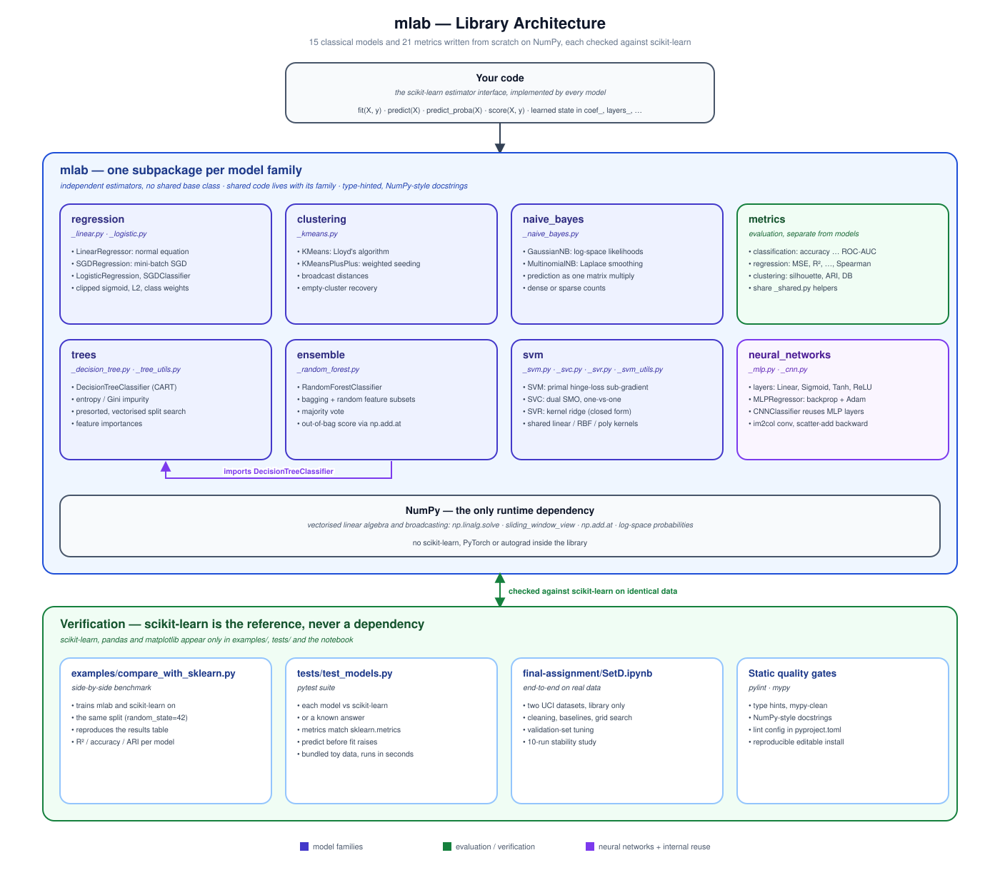
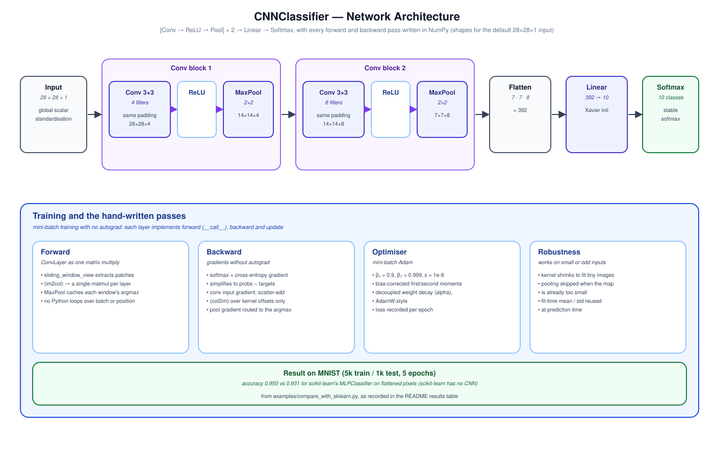

# Machine Learning Algorithms from Scratch

  

`mlab` is a library of 15 classical machine-learning models and 21 evaluation metrics, written from scratch using **only NumPy**: no scikit-learn, PyTorch or autograd inside the library. Every model follows the scikit-learn estimator interface (`fit` / `predict` / `predict_proba` / `score`). Each one is checked against its scikit-learn counterpart on the same data.

The repository started as weekly assignments in the Machine Learning Lab at the University of Passau. Submissions were graded by an automated pipeline that compared accuracy and coefficients against scikit-learn, ran pylint/mypy, and probed robustness with edge-case inputs.

**What it demonstrates**

- Turning the maths (closed-form solutions, gradients, dual optimisation, backpropagation) into working, vectorised NumPy code.
- Numerical-stability work: `linalg.solve` instead of matrix inversion, clipped sigmoid/log-loss, log-space probabilities, variance smoothing, gradient clipping.
- Performance engineering: profiling-driven vectorisation of tree split search, im2col-style convolution via `sliding_window_view`, and a scatter-add (col2im) convolution backward pass.
- Engineering hygiene: type hints (mypy-clean), NumPy-style docstrings, pylint 9.7/10, a pytest suite and a reproducible benchmark script.

## Architecture



Each model family is a self-contained subpackage behind the scikit-learn estimator interface, built on NumPy alone. scikit-learn sits outside the library and is used only to verify it.

### CNNClassifier



The convolutional network is the most involved model: every layer's forward and backward pass is hand-written, with convolution as a single matrix multiply and no autograd.

## Algorithms Implemented

All models are implemented from scratch. scikit-learn appears only in `examples/` and `tests/`, as the reference being compared against (plus `CountVectorizer` to turn text into counts).

| Algorithm | Problem | Method and key concepts | Source |
|---|---|---|---|
| `LinearRegressor` | Regression | Normal Equation solved with `np.linalg.solve`; optional ridge penalty (bias not regularised) | [`regression/_linear.py`](mlab/regression/_linear.py) |
| `SGDRegression` | Regression | Mini-batch stochastic gradient descent on MSE, optional L2 | [`regression/_linear.py`](mlab/regression/_linear.py) |
| `LogisticRegression` | Binary classification | Batch gradient descent on cross-entropy; L2; automatic class weighting when classes are imbalanced ≥ 3:1 | [`regression/_logistic.py`](mlab/regression/_logistic.py) |
| `SGDClassifier` | Binary classification | Mini-batch SGD on the same logistic loss | [`regression/_logistic.py`](mlab/regression/_logistic.py) |
| `KMeans` | Clustering | Lloyd's algorithm, random initialisation, centroid-shift convergence, empty-cluster recovery | [`clustering/_kmeans.py`](mlab/clustering/_kmeans.py) |
| `KMeansPlusPlus` | Clustering | Same loop with distance-weighted K-Means++ seeding | [`clustering/_kmeans.py`](mlab/clustering/_kmeans.py) |
| `GaussianNB` | Classification (continuous features) | Per-class Gaussian likelihoods in log space, scikit-learn-style variance smoothing | [`naive_bayes/_naive_bayes.py`](mlab/naive_bayes/_naive_bayes.py) |
| `MultinomialNB` | Text / count classification | Laplace smoothing; prediction as one matrix multiply; dense or sparse input | [`naive_bayes/_naive_bayes.py`](mlab/naive_bayes/_naive_bayes.py) |
| `DecisionTreeClassifier` | Classification | CART binary splits on entropy or Gini; presorted-index split search; feature importances | [`trees/_decision_tree.py`](mlab/trees/_decision_tree.py) |
| `RandomForestClassifier` | Classification | Bagging plus random feature subsets (`sqrt` by default), majority vote, out-of-bag score | [`ensemble/_random_forest.py`](mlab/ensemble/_random_forest.py) |
| `SVM` | Binary classification | Soft-margin linear SVM in the primal, sub-gradient descent on hinge loss | [`svm/_svm.py`](mlab/svm/_svm.py) |
| `SVC` | Classification | Kernel SVM in the dual via Platt's SMO; linear/RBF/polynomial kernels; one-vs-one multiclass | [`svm/_svc.py`](mlab/svm/_svc.py) |
| `SVR` | Regression | Kernel regression solved in closed form as kernel ridge regression (see [Limitations](#limitations)) | [`svm/_svr.py`](mlab/svm/_svr.py) |
| `MLPRegressor` | Regression | Composable layers (`Linear`, `Sigmoid`, `Tanh`, `ReLU`, `Softmax`) with manual backprop; Adam or SGD; He/Xavier init; early stopping | [`neural_networks/_mlp.py`](mlab/neural_networks/_mlp.py) |
| `CNNClassifier` | Image classification | `ConvLayer` and max-`PoolingLayer` with full backward passes; `[Conv → ReLU → Pool] × 2 → Linear → Softmax`; mini-batch Adam | [`neural_networks/_cnn.py`](mlab/neural_networks/_cnn.py) |

**Metrics** ([`mlab/metrics/`](mlab/metrics/)), each validated against `sklearn.metrics` (or `scipy.stats` for the correlations):

- **Classification:** `accuracy_score`, `precision_score`, `recall_score`, `f1_score` (binary/micro/macro/weighted), `confusion_matrix`, `classification_report`, `roc_auc_score` and `average_precision_score` (binary and one-vs-rest multiclass).
- **Regression:** `mean_squared_error`, `root_mean_squared_error`, `mean_absolute_error`, `mean_absolute_percentage_error`, `r2_score`, `explained_variance_score`, `pearson_correlation`, `spearman_correlation`, `regression_report`.
- **Clustering:** `silhouette_score`, `davies_bouldin_score`, `adjusted_rand_score`.

## Results

### Comparison with scikit-learn

These are test-set scores from [`examples/compare_with_sklearn.py`](examples/compare_with_sklearn.py) (80/20 split, `random_state=42`) on the datasets in [`datasets/`](datasets/README.md). Each row trains both libraries on identical data.

| Model | Dataset | Metric | mlab | scikit-learn |
|---|---|---|---:|---:|
| LinearRegressor | crop yield | R² | 0.596 | 0.596 |
| SGDRegression | crop yield | R² | 0.596 | 0.596 |
| SVR (RBF) | crop yield (2k train rows) | R² | 0.685 | 0.684 |
| MLPRegressor | crop yield | R² | 0.686 | 0.585 |
| LogisticRegression | user actions | accuracy | 0.650 | 0.650 |
| SGDClassifier | user actions | accuracy | 0.650 | 0.650 |
| SVM (linear) | user actions | accuracy | 0.650 | 0.650 |
| SVC (RBF) | user actions (2k train rows) | accuracy | 0.943 | 0.944 |
| GaussianNB | sensor XOR | accuracy | 0.465 | 0.465 |
| SVC (RBF) | sensor XOR | accuracy | 0.995 | 0.990 |
| MultinomialNB | support messages | accuracy | 1.000 | 1.000 |
| DecisionTreeClassifier | customer subscription | accuracy | 0.800 | 0.800 |
| RandomForestClassifier | customer subscription | accuracy | 0.816 | 0.824 |
| KMeans | 4 Gaussian blobs | adjusted Rand index | 0.995 | 0.995 |
| KMeansPlusPlus | 4 Gaussian blobs | adjusted Rand index | 0.995 | 0.995 |
| CNNClassifier (5 epochs) | MNIST, 5k train / 1k test | accuracy | 0.950 | 0.931 ¹ |

¹ scikit-learn has no CNN, so this row compares against `MLPClassifier` on flattened pixels.

**Reading the table:**

- **The low scores come from the datasets, not the models.** The course designed these datasets to expose each model's assumptions. `user_actions` places the positive class inside a ring, so every linear model (mlab and scikit-learn alike) can only predict the 65 % majority class; an RBF `SVC` on the same data reaches 0.94. `sensor_xor` is an XOR layout that breaks Naive Bayes' independence assumption; a kernel SVM separates it almost perfectly.
- `MLPRegressor` beats scikit-learn's default here mainly because it standardises inputs and targets internally; scikit-learn's estimator was given raw features.
- `MultinomialNB` scores 1.000 because the support-messages data is template-generated and trivially separable.
- The mlab SGD models take 6–11 s on this data versus well under a second for scikit-learn. They run a fixed 1,000 epochs in Python-level mini-batch loops, with no early stopping.

### End-to-end application on real data

[`final-assignment/SetD.ipynb`](final-assignment/SetD.ipynb) is the course's final practical task. It applies the library, and only the library, to two UCI datasets: data cleaning, a fixed train/validation/test split, baselines, grid-search tuning on the validation set, and a 10-run stability study with box plots. Test-set results as recorded in the notebook:

| Dataset | Model | Test results |
|---|---|---|
| [Mammographic Mass](https://archive.ics.uci.edu/dataset/161/mammographic+mass) (classification, 961 rows) | `RandomForestClassifier` (baseline) | accuracy 0.825, precision 0.815, recall 0.803 |
| | `LogisticRegression` (tuned) | accuracy 0.804, F1 0.800, ROC-AUC 0.858; recall 0.924 with a recall-oriented threshold of 0.30 |
| | `LogisticRegression`, 10 reshuffled runs | accuracy 0.828 ± 0.049 |
| [Airfoil Self-Noise](https://archive.ics.uci.edu/dataset/291/airfoil+self-noise) (regression, 1,503 rows) | `SVR` (baseline) | R² 0.895, MAE 1.54, RMSE 2.20 |
| | `MLPRegressor` (tuned) | R² 0.952, MAE 1.05, RMSE 1.48 |
| | `MLPRegressor`, 10 reshuffled runs | R² 0.946 ± 0.012 |

## Project Structure

```text
Machine-Learning-Algorithms/
├── mlab/                         # the library: NumPy only, one subpackage per model family
│   ├── regression/               #   _linear.py, _logistic.py
│   ├── clustering/               #   _kmeans.py
│   ├── naive_bayes/              #   _naive_bayes.py
│   ├── trees/                    #   _decision_tree.py, _tree_utils.py (impurity + split search)
│   ├── ensemble/                 #   _random_forest.py (builds on trees/)
│   ├── svm/                      #   _svm.py, _svc.py, _svr.py, _svm_utils.py (kernels)
│   ├── neural_networks/          #   _mlp.py (layers + MLP), _cnn.py (reuses the MLP layers)
│   └── metrics/                  #   _classification.py, _regression.py, _clustering.py, _shared.py
├── datasets/                     # synthetic course datasets + their generators (see datasets/README.md)
├── examples/
│   └── compare_with_sklearn.py   # reproduces the results table above
├── tests/
│   └── test_models.py            # pytest suite, ~6 s
├── final-assignment/
│   └── SetD.ipynb                # end-to-end application on two UCI datasets
├── pyproject.toml                # package metadata, dependencies, pylint/pytest config
└── LICENSE
```

**How the pieces fit.** This is a collection of independent estimators, not a pipeline framework, and the code stays deliberately flat:

- **One file per model family.** There is no shared base class; each estimator stands alone and exposes the scikit-learn conventions directly. Learned state uses trailing-underscore attributes (`coef_`, `cluster_centers_`, `feature_importances_`, `support_vectors_`, `layers_`, ...).
- **Shared code lives with its family.** Split search sits in `trees/_tree_utils.py`, kernels in `svm/_svm_utils.py`, and the layer classes in `neural_networks/_mlp.py` (also used by the CNN). Validation and ranking helpers live in `metrics/_shared.py`.
- **Preprocessing is the caller's job,** with two documented exceptions. The linear/logistic/SVM models expect inputs already standardised with training-set statistics. `MLPRegressor` and `CNNClassifier` standardise internally and undo it at prediction time.
- **Robustness is built into the estimators:** NaN imputation (trees, forests, SVMs), automatic class balancing past a 3:1 imbalance (logistic regression, trees, forests), and kernel/pool sizes that shrink automatically for very small images (CNN).
- **Evaluation is separate:** `mlab.metrics` works on any `(y_true, y_pred)` or `(X, labels)` pair.

## Technologies

| Area | Used for |
|---|---|
| Python 3.10+ (developed on 3.14) | Language |
| NumPy | The only runtime dependency: all model and metric code |
| pandas, scikit-learn | Examples and tests only: loading CSVs, reference models, `CountVectorizer`, toy datasets |
| matplotlib, seaborn | Dataset generators' optional plots, final-assignment box plots |
| pytest, pylint, mypy | Tests, linting, static type checking |
| Jupyter, `ucimlrepo` | Final-assignment notebook |
| setuptools (`pyproject.toml`) | Packaging, editable install |

## Installation

```bash
git clone https://github.com/AliAkbarBaloch/Machine-Learning-Algorithms.git
cd Machine-Learning-Algorithms

python3 -m venv .venv
source .venv/bin/activate            # Windows: .venv\Scripts\activate

pip install -e .                     # library only (NumPy)
pip install -e ".[examples,dev]"     # + examples, tests, linters
pip install -e ".[examples,notebook]"  # + Jupyter and ucimlrepo for the final-assignment notebook
```

If `ucimlrepo` fails to download the UCI data on macOS with a python.org build, run `Install Certificates.command` from the Python application folder (or set `SSL_CERT_FILE` to `certifi.where()`).

The MNIST CSVs are not committed (≈125 MB). They're only needed if you want the CNN row above on full MNIST; see [`datasets/README.md`](datasets/README.md). Without them, the example falls back to scikit-learn's bundled 8×8 digits.

## Usage

```python
import numpy as np
from mlab.svm import SVC
from mlab.metrics import accuracy_score, classification_report

rng = np.random.default_rng(0)
X = rng.normal(size=(400, 2))
y = (X[:, 0] ** 2 + X[:, 1] ** 2 > 1.5).astype(int)      # a circular boundary

model = SVC(kernel="rbf", C=1.0, random_state=0).fit(X[:300], y[:300])
y_pred = model.predict(X[300:])
print(accuracy_score(y[300:], y_pred))
print(classification_report(y[300:], y_pred))
```

The other estimators import the same way:

```python
from mlab.regression import LinearRegressor, SGDRegression, LogisticRegression, SGDClassifier
from mlab.clustering import KMeans, KMeansPlusPlus
from mlab.naive_bayes import GaussianNB, MultinomialNB
from mlab.trees import DecisionTreeClassifier
from mlab.ensemble import RandomForestClassifier
from mlab.svm import SVM, SVC, SVR
from mlab.neural_networks import MLPRegressor, CNNClassifier
```

**Run the comparison with scikit-learn** (about a minute; prints the table above plus timings):

```bash
python examples/compare_with_sklearn.py
```

**Run the tests and static checks:**

```bash
pytest                                   # 21 tests
pylint mlab
mypy mlab --ignore-missing-imports
```

**Regenerate the synthetic datasets:** see [`datasets/README.md`](datasets/README.md).

## Implementation Notes

- **Linear models.** The closed-form solver solves `(XᵀX + αI)w = Xᵀy` with `np.linalg.solve` and leaves the bias out of the penalty. The SGD variants shuffle every epoch and record `loss_history_`. Logistic regression clips logits to ±500 and probabilities by ε before taking logs.
- **K-Means.** Distances are computed with broadcasting, not loops. A cluster that loses all its points is re-seeded at the point farthest from its centroid instead of producing NaN centroids. K-Means++ samples each new seed with probability proportional to squared distance.
- **Naive Bayes.** Both variants work in log space. Gaussian NB adds `var_smoothing × max variance` to every variance, as scikit-learn does, so constant features don't produce `log(0)`. Multinomial NB uses the `N_k + αV` Laplace denominator, and its prediction is one matrix multiply.
- **Trees and forests.** The tree sorts every feature once per `fit`, then evaluates all thresholds of a feature in one pass using cumulative class counts. A forest node copies only its k randomly chosen columns. Out-of-bag votes are accumulated with `np.add.at`. These paths were found and vectorised by profiling with `cProfile`.
- **SVMs.** `SVC` implements SMO pair updates with KKT-violation checks and combines binary classifiers one-vs-one. The RBF kernel uses the expanded `‖x‖² + ‖z‖² − 2x·z` form, clipped at zero. `gamma='scale'` matches scikit-learn's formula.
- **Neural networks.** Each layer implements only `__call__` (forward), `backward` and `update`; the model wires them into a stack. `MLPRegressor` adds Adam with bias correction, decoupled weight decay, optional gradient-norm clipping, best-weights checkpointing and early stopping. `ConvLayer` turns convolution into a single matmul over `sliding_window_view` patches. Its input gradient is a scatter-add over the kernel offsets only; there are no loops over batch, position or channel.

## Limitations

- `SVR` solves kernel ridge regression `(K + I/C)c = y − b` in closed form. `epsilon` only decides which samples are reported as support vectors; this is not scikit-learn's ε-insensitive SVR. The solve is O(n³), and `SVC`/`SVR` keep a full n×n kernel matrix, so both suit thousands of rows, not millions.
- `SVM(kernel="rbf")` is a simplified element-wise feature map kept for API compatibility. Use `SVC` for real kernel methods.
- `LogisticRegression`/`SGDClassifier`/`SVM` are binary only. `MLPRegressor` does regression only and `CNNClassifier` classification only.
- `KMeans` runs a single initialisation (no `n_init`), so it can stop at a local optimum, just as scikit-learn does with `n_init=1`.
- `SGDRegression` shuffles with NumPy's global random state and has no `random_state` parameter.
- Everything runs on the CPU in pure NumPy. The SGD loops and the CNN are much slower than compiled libraries.
- Some classes expose extra alias names (`DecisionTree`, `GaussianNaiveBayes`, `centroids`, `get_depth()`, ...). They exist because the course's grader probed several spellings of the same interface.
- Developed and tested on Python 3.14 only. The `>=3.10` floor in `pyproject.toml` hasn't been tested.

## Academic Context

The implementations come from the Machine Learning Lab (summer semester 2026) at the University of Passau. Each week covered one algorithm family, and the final practical task applied the finished library to unseen datasets. The synthetic datasets and their generator scripts were provided by the course staff.

## License

[MIT](LICENSE) © 2026 Ali Akbar. The license covers the code in this repository. The course-provided dataset generators and synthetic datasets in `datasets/` remain the course staff's.
